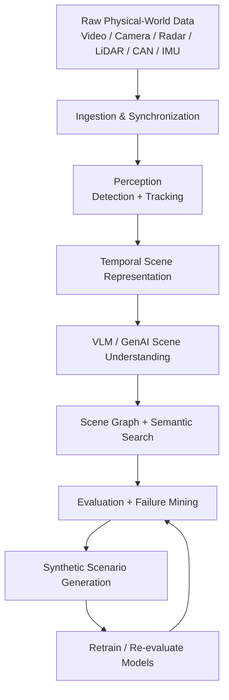
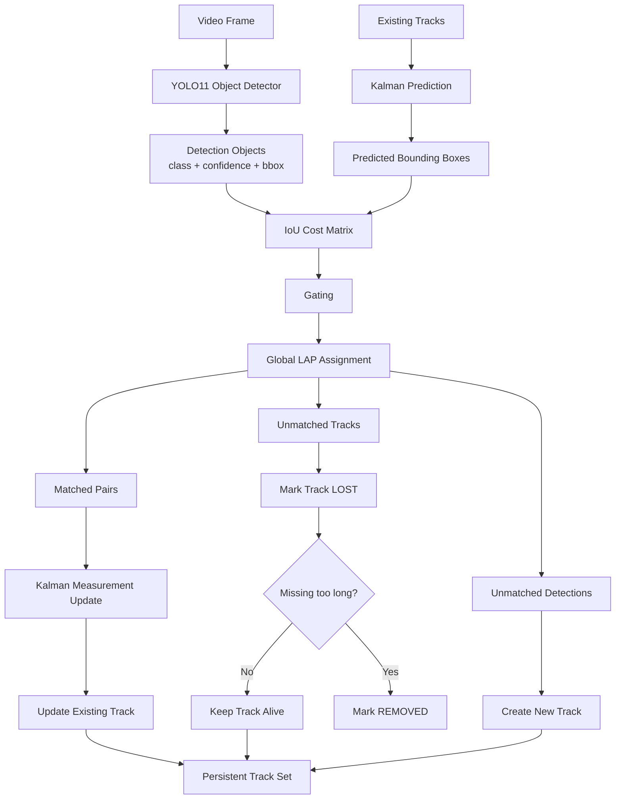
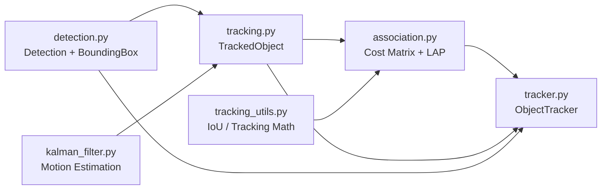
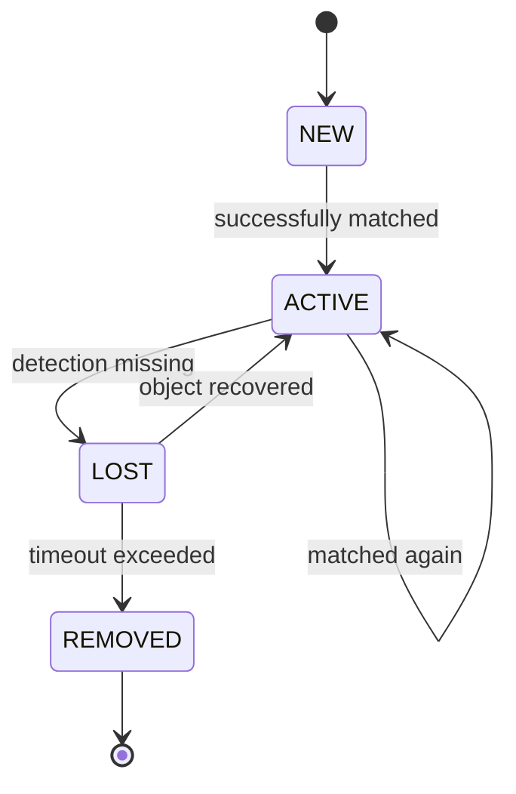
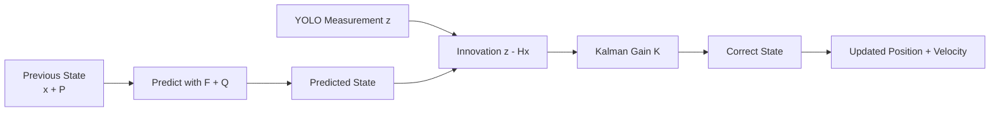
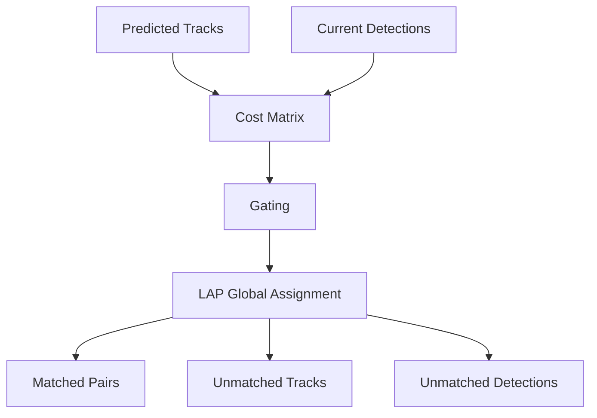
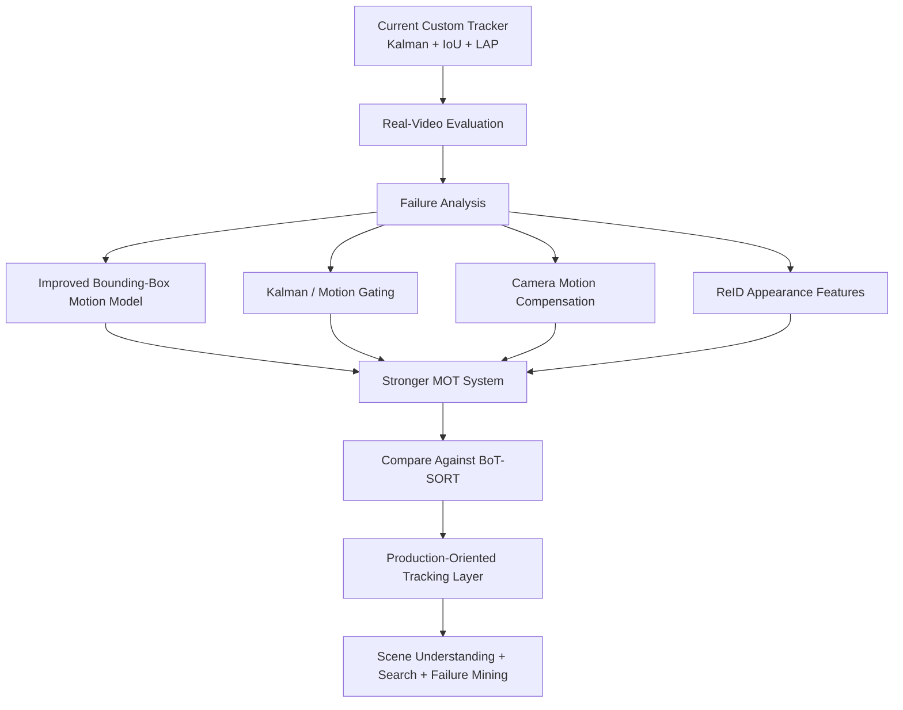

# PhysicalAI Data Engine

PhysicalAI Data Engine is a modular platform for converting raw physical-world sensor data into structured, searchable, explainable, and AI-ready scene intelligence.

The long-term goal is to create a reusable data engine for domains such as **ADAS / autonomous driving, robotics, warehouse automation, industrial systems, agriculture, drones, and security cameras**.

Instead of stopping at frame-level perception, the system is being designed to answer higher-level questions such as:

- What objects are present?
- Which object is which across time?
- How are those objects moving?
- What happened in a scene?
- Which scenarios are safety-critical or unusual?
- Where did a perception or decision model fail?
- Can those scenarios be searched, clustered, regenerated, and used for retraining?

---

## Product Vision



The platform direction is therefore:

```text
Raw data
   ↓
Perception
   ↓
Persistent temporal tracks
   ↓
Scene understanding
   ↓
Searchable scene intelligence
   ↓
Failure mining / evaluation
   ↓
Synthetic-data feedback loop
```

The current implementation starts with video because it provides a practical foundation for building and validating the full PhysicalAI pipeline.

---

## Current Roadmap

- ✅ Phase 0 — Environment and project foundation
- ✅ Phase 1 — Video ingestion and frame sampling
- ✅ Phase 2 — Object detection
- 🚧 Phase 3 — Multi-object tracking
- ⏳ Phase 4 — Persistent data engine + web UI
- ⏳ Phase 5 — VLM / GenAI scene understanding
- ⏳ Phase 6 — Scene graph + semantic search
- ⏳ Phase 7 — Model failure mining
- ⏳ Phase 8 — Synthetic scenario generation

---

# Current Milestone — Custom Multi-Object Tracking Core

Phase 3 extends frame-level object detection into **temporal identity and motion estimation**.

Object detection answers:

```text
What objects are visible in this frame?
Where are they?
```

Tracking adds:

```text
Is this the same object seen in previous frames?
What persistent ID should it have?
How is it moving?
What is its lifecycle state?
```

The project initially used **YOLO11 + BoT-SORT** as a baseline to study mature tracker behavior. The current milestone goes further by implementing the core tracking pipeline explicitly rather than treating the tracker as a black box.

---

## End-to-End Tracking Flow



---

## Software Architecture



The architecture separates responsibilities so each component can evolve independently.

### Core source files

| File | Responsibility |
|---|---|
| `detection.py` | Detector-neutral `Detection` and `BoundingBox` abstractions |
| `kalman_filter.py` | Motion state, covariance, prediction, correction |
| `tracking.py` | `TrackedObject`, lifecycle, trajectory and Kalman integration |
| `tracking_utils.py` | IoU and tracking-related math helpers |
| `association.py` | IoU cost matrix, gating and global LAP assignment |
| `tracker.py` | Frame-by-frame tracking orchestration |

---

# Detection Abstraction

Detector-specific output is converted into reusable objects:

```text
YOLO result
    ↓
Detection
├── class_id
├── class_name
├── confidence
└── BoundingBox
```

This prevents the downstream tracking system from being tightly coupled to Ultralytics.

That means the tracking architecture can later consume detections from another model, simulation, stored annotations, or a different perception stack.

---

# Persistent Track Object

A frame-level detection becomes a temporal object:

```text
TrackedObject
├── track_id
├── class
├── confidence
├── bbox
├── lifecycle state
├── age
├── hits
├── time_since_update
├── position history
└── KalmanFilter2D
```

A `Detection` represents a measurement in one frame.

A `TrackedObject` represents a persistent hypothesis about the same physical object across multiple frames.

---

## Track Lifecycle



This lets identity survive temporary occlusion or missed detections.

Key counters:

- `age` — number of frames the track has existed
- `hits` — number of successful detector associations
- `time_since_update` — number of frames since the last successful measurement update

---

# Kalman Motion Estimation

Each tracked object owns its own Kalman filter.

The current state is:

```text
[x, y, vx, vy]
```

where:

- `x, y` = bounding-box center position
- `vx, vy` = image-space velocity in pixels/frame

### Prediction model

```text
x_pred = F x
P_pred = F P F^T + Q
```

### Measurement update

```text
innovation = z - H x
S = H P H^T + R
K = P H^T S^-1
x = x + K innovation
P = (I - K H) P
```

Conceptually:



The detector measures position, while the filter estimates both position and velocity.

In validation, a track initialized with zero velocity learned motion from successive detector measurements, demonstrating that velocity can be inferred through the state covariance structure.

---

# Bounding-Box Prediction

The current Kalman model predicts the center point.

The predicted center is converted back into a bounding box using the current width and height:

```text
x1 = cx - width / 2
x2 = cx + width / 2
y1 = cy - height / 2
y2 = cy + height / 2
```

Current responsibility split:

```text
Kalman
→ filtered / predicted center

Detector
→ current bbox width and height
```

A later production-oriented version will move toward richer box-state dynamics.

---

# IoU-Based Association

IoU is implemented manually:

```text
IoU = intersection area / union area
```

For assignment:

```text
cost = 1 - IoU
```

Therefore:

```text
high IoU
→ low cost
→ stronger geometric match
```

Validated example:

```text
                Detection 0   Detection 1

Track 0           0.219         1.000
Track 1           1.000         0.174
```

The preferred assignment is therefore:

```text
Track 0 → Detection 0
Track 1 → Detection 1
```

---

# Gating and Global Assignment

A cost threshold rejects geometrically implausible candidates before or during assignment.

The project uses `lap.lapjv` to solve the complete assignment problem globally rather than matching greedily.



Association output explicitly contains:

- matched track/detection pairs
- unmatched tracks
- unmatched detections

That output directly drives tracker lifecycle logic.

---

# ObjectTracker Orchestration

`ObjectTracker.update(detections)` advances the tracker by one frame.

Per-frame logic:

```text
1. Age existing tracks
2. Predict every track using Kalman
3. Build predicted bboxes
4. Extract current detection bboxes
5. Construct IoU cost matrix
6. Apply gated global assignment
7. Kalman-update matched tracks
8. Mark unmatched tracks LOST
9. Remove tracks exceeding timeout
10. Create tracks for unmatched detections
11. Return persistent track set
```

This controller is the current core of the custom MOT implementation.

---

# Deterministic Multi-Frame Validation

Before running the custom tracker on a real video, the complete architecture was validated using controlled multi-frame detections.

### Frame 1

```text
Detection A → Track 1 → NEW
Detection B → Track 2 → NEW
```

### Frame 2

Both objects move and are successfully reassociated:

```text
Track 1 → ACTIVE
Track 2 → ACTIVE
```

### Frame 3

Only the first object is detected:

```text
Track 1 → ACTIVE
Track 2 → LOST
```

Observed counters:

```text
Track 1
age = 3
hits = 3
time_since_update = 0
state = ACTIVE

Track 2
age = 3
hits = 2
time_since_update = 1
state = LOST
```

This validates that the following components now work together:

- Kalman prediction
- covariance propagation
- predicted bounding boxes
- IoU cost computation
- gating
- LAP global assignment
- matched-track correction
- persistent IDs
- LOST-track handling
- lifecycle counters

---

# Current Phase 3 Status

```text
✅ YOLO11 object detection
✅ BoT-SORT baseline experiments
✅ Persistent-ID fundamentals
✅ Track lifecycle
✅ Image-space motion and velocity
✅ Kalman filter implemented from first principles
✅ Covariance propagation
✅ Measurement correction
✅ Predicted bounding boxes
✅ Manual IoU
✅ IoU cost matrix
✅ Gating
✅ LAP global assignment
✅ Matched / unmatched handling
✅ Custom ObjectTracker controller
✅ Deterministic multi-frame validation

Next:
⏳ Run the custom tracker on real video
⏳ Draw IDs, states and trajectories
⏳ Analyze ID switches and failure modes
⏳ Improve bounding-box motion state
⏳ Add camera-motion compensation / GMC
⏳ Add ReID / appearance features
⏳ Add stronger track confirmation / class stabilization
⏳ Compare custom tracker against BoT-SORT
```

---

# Engineering Direction

The current tracker is intentionally:

```text
not a toy implementation
not prematurely production-optimized
structurally production-minded
readable enough to explain and debug
designed to evolve rather than be discarded
```

Planned evolution:



The final objective is not only to track objects, but to create persistent temporal scene data that can feed the broader PhysicalAI Data Engine for **scene understanding, semantic search, evaluation, failure mining, and synthetic-data generation**.
