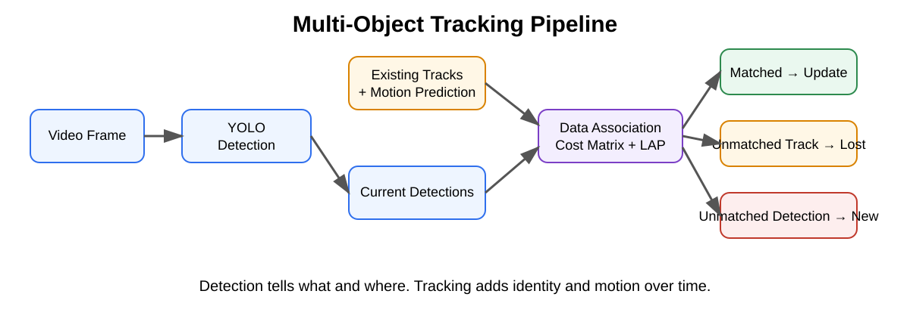

# PhysicalAI Data Engine

PhysicalAI Data Engine converts raw physical-world video into structured, searchable, and AI-ready data for perception, scene understanding, semantic search, evaluation, and future synthetic-data workflows.

<p align="center">
  
</p>

## Roadmap

- ✅ Phase 0 — Environment and project foundation
- ✅ Phase 1 — Video ingestion and frame sampling
- ✅ Phase 2 — Object detection
- 🚧 Phase 3 — Multi-object tracking
- ⏳ Phase 4 — Persistent data engine + web UI
- ⏳ Phase 5 — VLM / GenAI scene understanding
- ⏳ Phase 6 — Scene graph + semantic search
- ⏳ Phase 7 — Model failure mining
- ⏳ Phase 8 — Synthetic scenario generation

The platform direction is:

```text
Raw video / sensors
        ↓
Video ingestion
        ↓
Detection + tracking
        ↓
VLM / GenAI scene understanding
        ↓
Scene graph + semantic search
        ↓
Failure mining / evaluation
        ↓
Synthetic scenario generation
```

---

# Phase 3 — Multi-Object Tracking

Phase 3 extends frame-level detection into temporal object identity and motion estimation.

The current milestone now includes a **custom multi-object tracking core built from first principles**, in addition to earlier BoT-SORT experiments.

## Current custom tracking pipeline

```text
YOLO detections
      │
      ▼
Detection abstraction
      │
      ▼
Existing TrackedObject instances
      │
      ▼
Kalman prediction
      │
      ▼
Predicted bounding boxes
      │
      ├──────────────────────┐
      │                      │
      ▼                      ▼
Track boxes             Detection boxes
      │                      │
      └──────────┬───────────┘
                 ▼
            IoU cost matrix
                 │
                 ▼
               Gating
                 │
                 ▼
          Global LAP assignment
                 │
       ┌─────────┼───────────┐
       ▼         ▼           ▼
    Matched   Unmatched    Unmatched
     pairs      tracks     detections
       │         │           │
       ▼         ▼           ▼
   Kalman       LOST       Create
    update      state      new track
       │         │           │
       └─────────┼───────────┘
                 ▼
         Persistent track IDs
```

## Core implementation

### Detection abstraction

`src/physical_ai/perception/detection.py`

Detector-specific outputs are converted into reusable `Detection` and `BoundingBox` objects so downstream tracking code is not tightly coupled to Ultralytics.

### Track state and lifecycle

`src/physical_ai/perception/tracking.py`

Each `TrackedObject` owns:

- session-local track ID
- class and confidence
- latest filtered bounding box
- lifecycle state: `NEW`, `ACTIVE`, `LOST`, `REMOVED`
- `age`, `hits`, and `time_since_update`
- center-point history
- its own Kalman motion filter

Lifecycle:

```text
NEW
 │ matched
 ▼
ACTIVE
 │ missed
 ▼
LOST
 ├── matched again ──> ACTIVE
 └── timeout ────────> REMOVED
```

### Kalman motion estimation

`src/physical_ai/perception/kalman_filter.py`

The current learning-oriented state is:

```text
[x, y, vx, vy]
```

with constant-velocity prediction:

```text
x_pred = F x
P_pred = F P F^T + Q
```

Measurement update:

```text
innovation = z - H x
S = H P H^T + R
K = P H^T S^-1
x = x + K innovation
P = (I - K H) P
```

The detector measures center position while the filter estimates both position and image-space velocity.

### IoU association cost

`src/physical_ai/perception/tracking_utils.py`
`src/physical_ai/perception/association.py`

IoU is implemented manually:

```text
IoU = intersection area / union area
```

For assignment:

```text
cost = 1 - IoU
```

Therefore higher geometric overlap produces lower assignment cost.

Example validated output:

```text
[[0.21917808 1.        ]
 [1.         0.17355372]]
```

### Gating and global assignment

`src/physical_ai/perception/association.py`

The project uses `lap.lapjv` to solve the complete track-to-detection assignment problem rather than matching greedily.

A configurable maximum cost rejects implausible candidate associations.

The association result explicitly contains:

- matched track/detection pairs
- unmatched tracks
- unmatched detections

### Tracker orchestration

`src/physical_ai/perception/tracker.py`

`ObjectTracker.update(detections)` advances the tracker by one frame:

1. age existing tracks
2. predict each track using Kalman
3. construct the IoU cost matrix
4. solve gated global assignment
5. update matched tracks
6. mark unmatched tracks as lost
7. remove tracks that exceed the lost-frame timeout
8. create new tracks from unmatched detections

## Deterministic multi-frame validation

`scripts/demo_object_tracker.py` validates the complete custom tracker with controlled detections.

Observed behavior:

```text
Frame 1
Track 1 → NEW
Track 2 → NEW

Frame 2
Track 1 → ACTIVE, matched again
Track 2 → ACTIVE, matched again

Frame 3
Track 1 → ACTIVE, matched again
Track 2 → LOST, one frame since last update
```

This verifies that Kalman prediction, IoU association, LAP matching, persistent IDs, and lifecycle management work together.

## Phase 3 experiments and learning scripts

| Script | Purpose |
|---|---|
| `track_video_demo.py` | Run YOLO + BoT-SORT and inspect persistent track IDs |
| `inspect_tracks.py` | Inspect IDs, classes, confidence and bounding boxes |
| `track_lifecycle_demo.py` | Observe disappearing and reappearing tracks |
| `inspect_track_motion.py` | Inspect image-space object motion |
| `demo_iou.py` | Validate manual IoU |
| `demo_cost_matrix.py` | Understand IoU-based association cost |
| `demo_assignment.py` | Understand LAP global assignment |
| `demo_kalman_update.py` | Validate Kalman prediction and correction |
| `demo_track_kalman_integration.py` | Integrate Kalman into a persistent track |
| `demo_association_cost_matrix.py` | Build track-vs-detection IoU cost matrix |
| `demo_assignment_engine.py` | Run gated LAP association |
| `demo_object_tracker.py` | Validate the complete custom multi-frame tracker |

## Phase 3 status

```text
✅ YOLO object detection
✅ BoT-SORT baseline experiments
✅ Persistent ID fundamentals
✅ Track lifecycle
✅ Motion and image-space velocity
✅ Kalman filter implemented from first principles
✅ Covariance / prediction / measurement correction
✅ Predicted bounding boxes
✅ Manual IoU
✅ IoU cost matrix
✅ Gating
✅ LAP global assignment
✅ Matched / unmatched handling
✅ Custom ObjectTracker controller
✅ Deterministic multi-frame tracker validation

Next:
⏳ Run the custom tracker on real video
⏳ Visualize IDs, state and trajectories
⏳ Analyze ID switches and failure modes
⏳ Improve bounding-box motion state
⏳ Camera-motion compensation / GMC
⏳ Re-identification / appearance features
⏳ Compare custom tracker against BoT-SORT
```

## Engineering direction

The tracker is intentionally not a toy implementation and not prematurely production-optimized. The architecture is kept modular so the current components can evolve toward a production tracker:

```text
Detection
   ↓
Track state
   ↓
Motion model
   ↓
Association
   ↓
Lifecycle
   ↓
GMC / ReID / confidence fusion
   ↓
Evaluation and failure mining
```

The same tracking outputs will later feed the PhysicalAI Data Engine's scene understanding, semantic search, evaluation, and synthetic-data workflows.
